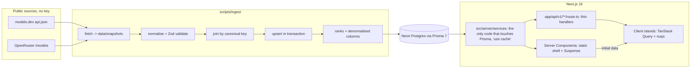

# OneAtlas

Find, compare and rank AI models across labs and API providers. OneAtlas covers specs, per-provider pricing, capabilities and benchmarks, all served from Postgres through a typed REST API.

**Live:** _added after the Vercel deploy_ · **API:** `/api/v1` ([contract](docs/05-api-spec.md)) · **Role:** Full Stack Engineer take-home

| | |
|---|---|
| Catalog | 724 models · 91 labs · 307 providers · 8,618 provider listings · 30 benchmarks (1,964 scores) |
| Stack | Next.js 16 (App Router, Cache Components) · React 19 · TypeScript · Tailwind 4 · Node route handlers · PostgreSQL on Neon · Prisma 7 · Zod 4 · TanStack Query 5 · nuqs 2 |
| Quality | 63 unit tests (Vitest) · Playwright smoke spec · Lighthouse mobile 87 to 90 performance and 100 accessibility / best practices on the main pages |

## What you can do

- **Explore** (`/`): search with typo-tolerant matching ("gpt4o" finds GPT-4o), faceted filters with live counts (lab, provider, type), capability chips, sort by price, context, release date, intelligence, value or availability. Switch between table and cards. Every filter lives in the URL, so views are shareable and the back button works.
- **Model pages** (`/models/{lab}/{slug}`): stat tiles, reference pricing plus a monthly cost calculator, capabilities and modalities, benchmark bars with "#rank of N", Design Arena results, rank chips for every leaderboard, and every provider listing with that provider's own prices.
- **Compare** (`/compare?ids=…`): 2 to 4 models side by side. The best value in each row is marked with a label as well as colour, there's a "differences only" toggle, a cost calculator at the cheapest provider, and a share link.
- **Rankings** (`/rankings/{board}`): reach, intelligence, value, cheapest, context, newest and all 30 benchmarks. Filter by lab, type and capability (ranks are recomputed for the filtered set). Includes a "labs in the top 100" panel and a price vs intelligence scatter that traces the value frontier.
- **Benchmarks** (`/benchmarks`): a catalogue with each benchmark's leader, plus a score matrix with selectable columns where the best score in each column is highlighted.
- **Labs and providers**: directories, lab pages (models, served-by providers), provider pages (models with that provider's prices).
- **Ask the code**: a chat panel (header button, hero button or `Ctrl/Cmd+K` → "Ask the code") that explains how this app is built. By default it serves **32 prepared answers**, ordered by importance, written against the real code and free to run. Each plays back like a live answer: a reading trail ("Read src/…"), streamed text, `path:line` citations that open the exact lines, and follow-up questions. Unmatched questions get the closest suggestions. A **Live** mode (Claude reading the code through tools) is fully built and switches on when `ANTHROPIC_API_KEY` is set.
- **Code** (`/code`): the whole codebase in an editor-style viewer, with a file tree showing each file's purpose, tabs, breadcrumbs, syntax highlighting (in-house, no dependency), search across files and `Ctrl+P` quick open. Every line has a shareable link (`/code?path=…&line=…`), and source citations in Ask the code open there.
- **Look and feel**: pointer-reactive headings (letters near the mouse turn gold and grow), a canvas-drawn 3D globe in the hero (drag to spin), scroll-driven 3D section reveals, rolling odometer numbers, pointer-tilt cards, a 3D podium on leaderboards and growing score bars. A six-hue palette (light and dark) colour-codes capabilities, model types, benchmark groups, medals and labs. All CSS or canvas with no animation library, and all switched off under `prefers-reduced-motion`.
- **Everywhere**: `Ctrl/Cmd+K` command palette, `/` to focus search, a light/dark switch (follows the OS on first visit, no flash), a compare tray, and loading, empty and error states.

## Architecture



- **One request, end to end:** a filter change updates the URL (nuqs), which changes the TanStack Query key. The client calls `GET /api/v1/models?…`, the route handler validates the query with the shared Zod schema, and the service builds one `Prisma.ModelWhereInput` and queries Postgres. The mapper converts `Decimal`/`Date` to plain JSON, and the response comes back in the `{ data, meta }` envelope. The server-rendered first page uses the same service and the same canonical query string, so hydration never refetches.
- **Layers:** route handlers parse, call a service and shape the response. Services hold the logic and are the only Prisma users. Server Components call the same services. See [`docs/03-architecture.md`](docs/03-architecture.md) for the decision log (every deviation from the plan is recorded there).
- **Caching:** service reads use `'use cache'` + `cacheLife('hours')` + `cacheTag('catalog')`, and API responses set `s-maxage=300, stale-while-revalidate=3600`. After a re-seed, `POST /api/internal/revalidate` (bearer secret) expires the whole catalog at once.
- **Errors:** every input goes through Zod and returns `400 INVALID_QUERY` with field details. Unknown entities return `404 NOT_FOUND`. Anything else returns `500 INTERNAL` with a request id, and database messages never reach clients.

## Data pipeline

The key insight is that models.dev already resolves 8,618 provider listings to **658 canonical models** (`canonical_model_id`). That's the spine. OpenRouter adds descriptions and benchmarks (Artificial Analysis indices, Design Arena Elo).

1. `npm run ingest:fetch` downloads both sources to `data/snapshots/` (committed, so seeding is deterministic and offline).
2. `npm run db:seed` validates every row with Zod (bad rows are logged and skipped, never crash the run). It then groups rows by canonical id and joins OpenRouter with a tested key: a lab alias map (`qwen → alibaba`, `z-ai → zhipuai`, …) plus a slug normaliser that drops `:variant` suffixes, trailing dates and punctuation.
   - **Join result:** 284 of 350 OpenRouter keys match, 5 are ambiguous and all resolved, and 66 become OpenRouter-only models.
   - **Derived fields:** reference price (first-party → OpenRouter → median), provider count, search key, competition ranks per benchmark, intelligence and value scores.
   - **Writes:** labs, providers and models are upserted; listings and scores are replaced in one transaction.
3. The seed is idempotent (two runs give identical counts) and prints a report checked against sanity bands. A full run takes about 55 s against Neon.

Prices are USD per 1M tokens everywhere. Blended = (3 × input + output) / 4. Value = intelligence / blended price. These formulas were checked against oneatlas.dev for Claude Opus 5.5: $4 / $20 gives a blended $8.00, and value 7.4 at intelligence 59.1.

## Run it locally

Requires Node 22+ and a Postgres database (a free Neon project works).

```bash
npm install                    # also runs prisma generate
cp .env.example .env           # DATABASE_URL (pooled) + DIRECT_URL (direct); optional REVALIDATE_SECRET, ANTHROPIC_API_KEY
npm run db:deploy              # migrations: tables, indexes, pg_trgm + trigram index
npm run db:seed                # ingest data/snapshots (about 1 min)
npm run dev                    # http://localhost:3000
```

Checks: `npm run typecheck && npm run lint && npm test && npm run build`, then `npm run test:e2e` (Playwright, starts `next start` on port 3300). To refresh source data, run `npm run ingest:fetch` and then `npm run db:seed`.

## API summary

All endpoints are `GET` under `/api/v1` unless marked otherwise. The full contract is in [`docs/05-api-spec.md`](docs/05-api-spec.md).

| Endpoint | Purpose |
|---|---|
| `/models` | List with `q, lab, provider, type, capability, inputModality, outputModality, minContext, maxPrice, includeDeprecated, sort, order, page, pageSize` (max 100) |
| `/models/{lab}/{slug}` | Detail: listings, benchmarks with rank, ranks on every board |
| `/compare?ids=a/b,c/d` | 2 to 4 model details + union of benchmark keys |
| `/search?q=` | Models, labs and providers for the command palette |
| `/facets` | Filter counts given the other active filters |
| `/stats`, `/health` | Catalog totals and capability coverage; DB liveness (never cached) |
| `/labs`, `/labs/{lab}` | Lab directory and lab page data |
| `/providers`, `/providers/{provider}` | Provider directory and paginated listings with the provider's prices |
| `/rankings/{board}` | Core boards or any benchmark key, filtered and ranked |
| `/benchmarks`, `/benchmarks/matrix` | Catalogue with leaders; score matrix |
| `POST /explain` | "Ask the code" assistant: streamed NDJSON (tool steps, answer text), rate limited |
| `/explain/source` | Source lines around a citation, from the bundled code snapshot |
| `/code`, `/code/file`, `/code/search` | File tree, one file, and line search over the same snapshot (powers `/code`) |
| `POST /api/internal/revalidate` | Bearer-protected cache invalidation after a re-seed |

```bash
curl "localhost:3000/api/v1/models?q=gpt4o&capability=tools&pageSize=5"
curl "localhost:3000/api/v1/models?pageSize=1000"   # 400 INVALID_QUERY with field details
curl "localhost:3000/api/v1/models/nope/nothing"     # 404 NOT_FOUND
```

## Ask the code (how the assistant works)

**Prepared mode (default, free).** `src/components/ask/knowledge.ts` holds 32 question-and-answer pairs ordered by importance, with keywords for matching typed questions and follow-up links. Answers cite code with anchors such as `{{src/server/http.ts|export function handler}}`. `npm run codeindex` resolves every anchor to its current line number and **fails the build if the cited text has moved**, so citations cannot drift. The panel plays an answer back with a reading trail and streamed text; an unmatched question gets the three closest prepared questions.

**Live mode (kept, off without a key).**
1. The same script snapshots allow-listed source and docs into `src/generated/code-index.json` (never `.env` or `data/`).
2. `POST /api/v1/explain` validates the chat, rate-limits per client and runs a bounded loop on Claude Opus 5.5 (`src/server/explain/assistant.ts`) with three read-only tools (`src/server/explain/code-tools.ts`), streaming NDJSON to the panel.
3. `GET /api/v1/explain` tells the panel whether Live is available.

Set `ANTHROPIC_API_KEY` to show the Live toggle. Cost control: at most 6 tool rounds, prompt caching, 12 questions per 10 minutes per client.

## Key decisions

| Decision | Why |
|---|---|
| Next.js route handlers, not NestJS | One repo, one deploy, Zod schemas and types shared by API, pages and client |
| Service layer is the only Prisma user | Logic in one place, reused by API and Server Components, testable pieces split out (`model-where.ts`) |
| SSR first page + client API calls | Fast first paint and a real, visible API integration; one shared query string means no double fetch |
| `pg_trgm` on a normalised `searchKey` | "gpt4o", "claude son" and other partial or typo queries work with no search infrastructure |
| Denormalised hot columns (`providerCount`, `intelligenceIndex`, `valueScore`, `blendedPrice`) and precomputed ranks | Sorts and leaderboards need no joins or aggregation at request time; data only changes at ingest |
| `Decimal(12,6)` money in the DB, `number` in DTOs | Exact sub-cent prices; conversion happens only in the mapper |
| URL is the state (nuqs) | Every view is shareable and back-button safe |

## Security

- No secrets reach the browser: no `NEXT_PUBLIC_` variables, database and API keys are read only in server code, and the build output and code snapshot are scanned for secret values (none found). The code snapshot excludes `.env*` and generated files; paths outside it return 404, so there is no file traversal.
- Every query input is validated with Zod (lengths, ranges, slug patterns); `ILIKE` wildcards in user text are escaped; raw SQL is parameterised.
- Headers on every response: CSP (same-origin scripts, styles, fonts and fetches; no framing; no plugins), `X-Content-Type-Options`, `X-Frame-Options: DENY`, `Referrer-Policy`, `Permissions-Policy`, HSTS. `X-Powered-By` is off.
- `POST /explain` is rate-limited per client (12 per 10 minutes), caps the body at 256 KB and the question at 2,000 characters; links in model output may only be http(s) or same-site. The revalidate endpoint compares its token in constant time and answers 404 to anything else.
- Errors use the JSON envelope (unknown `/api/*` paths included) and never include Prisma or Postgres messages.

## Limitations

- Coverage: models.dev rows without a canonical id (1,405, mostly small gateways) are not ingested, and OpenRouter exposes no coding or agentic index today. So the catalog has 724 models against oneatlas.dev's 1,118.
- Provider counts are 15 to 30% higher than oneatlas.dev because every models.dev provider id counts separately (plans and regional variants included).
- Unknown model URLs render the branded 404 page with HTTP 200: the streamed static shell is sent before `notFound()` runs. The API returns a real 404.
- Filtered ranks, search relevance and the benchmark matrix are computed in memory over at most about 1k light rows. That's fine at this size; the 100x plan is below.
- The CSP allows inline scripts: nonces would make every page render per request and give up the prerendered shells. Everything else is locked to this origin.
- No auth, writes, live provider uptime or long-context price tiers (out of scope).

## What I would do next

1. **Scale (100x):** keyset pagination, `RANK() OVER` / materialised views refreshed at ingest, `tsvector` or a search service, read replicas, edge rate limiting.
2. **Data:** orphan-row ingestion, long-context and batch price tiers, OpenRouter endpoint uptime and latency, the Artificial Analysis API for coding and agentic indices.
3. **Ops:** scheduled `ingest:fetch` + seed + revalidate in CI, request-id response header, error tracking.

## Data sources and attribution

Model, provider and price data come from [models.dev](https://models.dev). Descriptions and benchmark feeds come from [OpenRouter](https://openrouter.ai/models). Benchmarks are by [Artificial Analysis](https://artificialanalysis.ai) and [Design Arena](https://www.designarena.ai). Lab "logos" are generated initials: no third-party logos or assets are used. All data is public and keyless; snapshots are dated in `data/snapshots/MANIFEST.json`.
