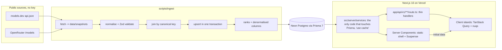

# OneAtlas

Find, compare and rank AI models across labs and API providers. OneAtlas covers specs, per-provider pricing, capabilities and benchmarks, all served from Postgres through a typed REST API.

**Live:** _added after the Vercel deploy_ · **Repo:** [github.com/Srinidhi2504/oneatlas](https://github.com/Srinidhi2504/oneatlas) · **API:** `/api/v1` ([contract](docs/05-api-spec.md)) · **Role:** Full Stack Engineer take-home

| | |
|---|---|
| Catalog | 724 models · 91 labs · 307 providers · 8,618 provider listings · 30 benchmarks (1,964 scores) |
| Stack | Next.js 16 (App Router, Cache Components) · React 19 · TypeScript · Tailwind 4 · Node route handlers · PostgreSQL on Neon · Prisma 7 · Zod 4 · TanStack Query 5 · nuqs 2 |
| Quality | 76 unit tests (Vitest) · 4 Playwright end-to-end tests · Lighthouse mobile 91 to 94 performance, 100 accessibility, 100 best practices, CLS 0 |
| Hosting | Vercel (functions in `iad1`) + Neon Postgres (`aws-us-east-1`) |

## What you can do

- **Explore** (`/`): typo-tolerant search ("gpt4o" finds GPT-4o), faceted filters with live counts (lab, provider, type), capability chips, sort by price, context, release date, intelligence, value or availability, table or card view. Every filter lives in the URL, so views are shareable and the back button works.
- **Model pages** (`/models/{lab}/{slug}`): stat tiles, reference pricing and a monthly cost calculator, capabilities and modalities, benchmark bars with "#rank of N", Design Arena results, rank chips for every leaderboard, and every provider listing at that provider's own prices.
- **Compare** (`/compare?ids=…`): 2 to 4 models side by side. The best value in each row is labelled (not colour alone), with a "differences only" toggle, a cost calculator at the cheapest provider and a share link.
- **Rankings** (`/rankings/{board}`): reach, intelligence, value, cheapest, context, newest and all 30 benchmarks. Filter by lab, type and capability (ranks are recomputed for the filtered set). Includes a "labs in the top 100" panel and a price vs intelligence chart that traces the value frontier.
- **Benchmarks** (`/benchmarks`): a catalogue with each benchmark's leader and a score matrix with selectable columns, best score per column highlighted.
- **Labs and providers**: directories, lab pages (models, providers serving them) and provider pages (models at that provider's prices).
- **Code** (`/code`): the whole codebase in an editor-style viewer: file tree with each file's purpose, tabs, breadcrumbs, syntax highlighting, search across files, `Ctrl+P` quick open and shareable line links. **Download ZIP** gives you the complete repository exactly as deployed.
- **Ask the code**: a chat panel that explains how this app is built. It serves 32 prepared answers (free, ordered by importance) that play back with a reading trail, streamed text, `path:line` citations that open the exact lines, and follow-ups. A Live mode (Claude reading the code through tools) switches on when `ANTHROPIC_API_KEY` is set.
- **Look and feel**: gold, black and warm-white palette in light and dark, pointer-reactive headings (letters near the mouse turn gold and grow), a canvas 3D globe, scroll-driven reveals, odometer numbers, a 3D podium. CSS and canvas only, and all of it off under `prefers-reduced-motion`.
- **Everywhere**: `Ctrl/Cmd+K` command palette, `/` to focus search, light/dark switch (follows the OS on first visit), a compare tray, and loading, empty and error states. Full-width layout from 360 px phones to 2560 px monitors.

## Architecture



- **One request, end to end:** a filter change updates the URL (nuqs), which changes the TanStack Query key. The client calls `GET /api/v1/models?…`; the route handler validates the query with the shared Zod schema; the service builds one `Prisma.ModelWhereInput` and queries Postgres; the mapper converts `Decimal`/`Date` to plain JSON; the response comes back in the `{ data, meta }` envelope. The server-rendered first page uses the same service and the same query key, so hydration never refetches.
- **Layers:** route handlers parse, call a service and shape the response. Services hold the logic and are the only Prisma users. Server Components call the same services.
- **Caching:** service reads use `'use cache'` + `cacheLife('hours')` + `cacheTag('catalog')`; API responses set `s-maxage=300, stale-while-revalidate=3600`; shells are prerendered. After a re-seed, `POST /api/internal/revalidate` (bearer secret) expires the whole catalog at once.
- **Errors:** every input goes through Zod and returns `400 INVALID_QUERY` with field details. Unknown entities return `404 NOT_FOUND`. Anything else returns `500 INTERNAL` with a request id; database messages never reach clients.

Full design: [system design](docs/09-system-design.md) · [database design](docs/10-database-design.md) · [decision log](docs/03-architecture.md).

## Data pipeline

The key insight: models.dev already resolves 8,618 provider listings to **658 canonical models** (`canonical_model_id`). That is the spine. OpenRouter adds descriptions and benchmarks (Artificial Analysis indices, Design Arena Elo).

1. `npm run ingest:fetch` downloads both sources to `data/snapshots/` (committed, so seeding is deterministic and offline).
2. `npm run db:seed` validates every row with Zod (bad rows are logged and skipped, never crash the run), groups rows by canonical id and joins OpenRouter with a tested key: a lab alias map (`qwen → alibaba`, `z-ai → zhipuai`, …) plus a slug normaliser that drops `:variant` suffixes, trailing dates and punctuation.
   - **Join result:** 284 of 350 OpenRouter keys match, 5 are ambiguous and all resolved, 66 become OpenRouter-only models.
   - **Derived fields:** reference price (first-party → OpenRouter → median), provider count, search key, competition ranks per benchmark, intelligence and value scores.
   - **Writes:** labs, providers and models are upserted; listings and scores are replaced in one transaction.
3. The seed is idempotent (two runs give identical counts), prints a report checked against sanity bands, and takes about 55 s against Neon.

Prices are USD per 1M tokens everywhere. Blended = (3 × input + output) / 4. Value = intelligence / blended price.

## Project structure

```
src/app/            routes: pages + /api/v1 route handlers
src/server/         services (the only database access), mappers, validation wrapper, rate limiter, code snapshot
src/lib/            shared logic: Prisma client, Zod schemas, types, pricing, ranking, formatting
src/components/     React components by feature (explorer, models, compare, rankings, code, ask, ui, ...)
scripts/            ingestion pipeline and the build-time code snapshot / ZIP
data/snapshots/     committed source data (the seed's only input)
prisma/             schema and migrations
e2e/                Playwright tests
docs/               requirements, research, architecture, data model, API, frontend, roadmap, deploy, system and database design
```

Every source file starts with a one-line comment saying what it is for (the `/code` file tree shows it).

## Run it locally

Requires Node 24 and a Postgres database (a free Neon project works).

```bash
npm install                    # also runs prisma generate and builds the code snapshot
cp .env.example .env           # DATABASE_URL (pooled) + DIRECT_URL (direct); optional REVALIDATE_SECRET, ANTHROPIC_API_KEY
npm run db:deploy              # migrations: tables, indexes, pg_trgm + trigram index
npm run db:seed                # load data/snapshots (about 1 minute)
npm run dev                    # http://localhost:3000
```

Checks: `npm run typecheck && npm run lint && npm test && npm run build`, then `npm run test:e2e` (starts `next start` on port 3300). To refresh source data, run `npm run ingest:fetch` and then `npm run db:seed`.

## Deploy (Vercel)

1. Import the GitHub repo in Vercel (framework preset Next.js; keep the default install and build commands).
2. Add `DATABASE_URL` (Neon pooled string) for Production and Preview. It is needed at build time too, because pages are prerendered from the database. Optional: `REVALIDATE_SECRET`, `ANTHROPIC_API_KEY`.
3. Deploy, then check `/api/v1/health`.

`vercel.json` pins functions to `iad1`, next to the database. The full runbook (verification checklist, data refresh, schema changes, troubleshooting) is in [`docs/08-deploy-and-submission.md`](docs/08-deploy-and-submission.md).

## API summary

All endpoints are `GET` under `/api/v1` unless marked otherwise. The full contract is in [`docs/05-api-spec.md`](docs/05-api-spec.md).

| Endpoint | Purpose |
|---|---|
| `/models` | List with `q, lab, provider, type, capability, inputModality, outputModality, minContext, maxPrice, includeDeprecated, sort, order, page, pageSize` (max 100) |
| `/models/{lab}/{slug}` | Detail: listings, benchmarks with rank, ranks on every board |
| `/compare?ids=a/b,c/d` | 2 to 4 model details + union of benchmark keys |
| `/search?q=` | Models, labs and providers for the command palette |
| `/facets` | Filter counts given the other active filters |
| `/stats`, `/health` | Catalog totals and capability coverage; DB liveness (never cached) |
| `/labs`, `/labs/{lab}` | Lab directory and lab page data |
| `/providers`, `/providers/{provider}` | Provider directory and paginated listings at the provider's prices |
| `/rankings/{board}` | Core boards or any benchmark key, filtered and ranked |
| `/benchmarks`, `/benchmarks/matrix` | Catalogue with leaders; score matrix |
| `/code`, `/code/file`, `/code/search` | File tree, one file and line search over the code snapshot |
| `POST /explain`, `/explain/source` | "Ask the code" Live mode (streamed NDJSON, rate limited) and citation source lines |
| `POST /api/internal/revalidate` | Bearer-protected cache invalidation after a re-seed |

```bash
curl "localhost:3000/api/v1/models?q=gpt4o&capability=tools&pageSize=5"
curl "localhost:3000/api/v1/models?pageSize=1000"   # 400 INVALID_QUERY with field details
curl "localhost:3000/api/v1/models/nope/nothing"     # 404 NOT_FOUND
```

## Ask the code

**Prepared mode (default, free).** `src/components/ask/knowledge.ts` holds 32 question-and-answer pairs ordered by importance, with keywords for matching typed questions. Answers cite code with anchors such as `{{src/server/http.ts|export function handler}}`; the build resolves every anchor to its current line number and **fails if the cited text has moved**, so citations cannot drift.

**Live mode (off without a key).** `POST /api/v1/explain` runs a bounded loop on Claude Opus 5.5 with three read-only tools over the build-time code snapshot, streaming NDJSON to the panel. Cost control: at most 6 tool rounds, prompt caching, 12 questions per 10 minutes per client.

## Key decisions

| Decision | Why |
|---|---|
| Next.js route handlers, not NestJS | One repo, one deploy, Zod schemas and types shared by API, pages and client |
| Service layer is the only Prisma user | Logic in one place, reused by API and Server Components, testable pieces split out (`model-where.ts`) |
| SSR first page + client API calls | Fast first paint and a real, visible API integration; one shared query key means no double fetch |
| `pg_trgm` on a normalised `searchKey` | "gpt4o", "claude son" and other partial or typo queries work with no search infrastructure |
| Denormalised hot columns and precomputed ranks | Sorts and leaderboards need no joins or aggregation at request time; data only changes at ingest |
| `Decimal(12,6)` money in the DB, `number` in DTOs | Exact sub-cent prices; conversion happens only in the mapper |
| URL is the state (nuqs) | Every view is shareable and back-button safe |
| Build-time code snapshot + static ZIP | `/code`, the download and the assistant always match the deployed commit, with no runtime file access |

## Security

- No secrets reach the browser: no `NEXT_PUBLIC_` variables; keys are read only in server code; build output and the code snapshot are checked for secret values. The snapshot excludes `.env*` and generated files, and file requests are matched against it rather than the disk, so there is no traversal.
- Every input is validated with Zod; `ILIKE` wildcards are escaped; raw SQL is parameterised.
- Every response carries CSP, `X-Content-Type-Options`, `X-Frame-Options: DENY`, `Referrer-Policy`, `Permissions-Policy` and HSTS; `X-Powered-By` is off.
- `POST /explain` is rate-limited, size-capped and restricts links in model output; the revalidate endpoint compares its token in constant time and answers 404 otherwise.

## Limitations

- Coverage: models.dev rows without a canonical id (mostly small gateways) are not ingested, and OpenRouter exposes no coding or agentic index today.
- Provider counts run higher than curated directories because every models.dev provider id counts separately (plans and regional variants included).
- Unknown model URLs render the branded 404 page with HTTP 200 (the streamed static shell is sent before `notFound()` runs). The API returns a real 404.
- Filtered ranks, search relevance and the benchmark matrix are computed in memory over at most about 1k light rows: fine at this size, see the 100x plan.
- The CSP allows inline scripts: nonces would make every page render per request and give up the prerendered shells.
- No auth, writes, live provider uptime or long-context price tiers (out of scope).

## What I would do next

1. **Scale (100x):** keyset pagination, `RANK() OVER` or materialised views refreshed at ingest, `tsvector` or a search service, read replicas, edge rate limiting ([details](docs/09-system-design.md#8-capacity-and-scaling)).
2. **Data:** ingest rows without canonical ids, long-context and batch price tiers, provider uptime and latency, the Artificial Analysis API for coding and agentic indices.
3. **Ops:** scheduled fetch + seed + revalidate in CI, an `x-request-id` header, error tracking.

## Documentation

| Doc | Contents |
|---|---|
| [01 Requirements](docs/01-requirements.md) | The brief, rubric and acceptance criteria |
| [02 Research](docs/02-research.md) | Source analysis behind the data decisions |
| [03 Architecture](docs/03-architecture.md) | Decisions (ADR-lite) and the decision log |
| [04 Data model and ingestion](docs/04-data-model-and-ingestion.md) | What the data means, source mapping, join key, pipeline |
| [05 API spec](docs/05-api-spec.md) | Endpoints, parameters, envelopes, errors |
| [06 Frontend spec](docs/06-frontend-spec.md) | Routes, components, UX and URL state |
| [07 Roadmap](docs/07-roadmap.md) | Build plan and status |
| [08 Deploy and submission](docs/08-deploy-and-submission.md) | Vercel runbook, data refresh, troubleshooting, QA checklist |
| [09 System design](docs/09-system-design.md) | Components, flows, caching, reliability, security, performance, scaling |
| [10 Database design](docs/10-database-design.md) | ERD, table dictionary, constraints, indexes per query, migrations |

## Data sources and attribution

Model, provider and price data come from [models.dev](https://models.dev). Descriptions and benchmark feeds come from [OpenRouter](https://openrouter.ai/models). Benchmarks are by [Artificial Analysis](https://artificialanalysis.ai) and [Design Arena](https://www.designarena.ai). Lab "logos" are generated initials; no third-party logos or assets are used. All data is public and keyless; snapshots are dated in `data/snapshots/MANIFEST.json`.
