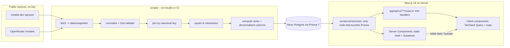

# 03 Architecture and decisions

## System at a glance



## Decisions (ADR-lite)

| # | Decision | Why | Rejected alternative |
|---|----------|-----|----------------------|
| D1 | **Next.js route handlers** for the backend, not NestJS | One repo, one deploy (Vercel), types/Zod shared with the UI, far less glue. The brief allows either. Clean layering inside gives the same architectural story | NestJS: second deployable + DTO duplication for no MVP gain |
| D2 | **Service layer** (`src/server/services`) is the only Prisma user; routes and Server Components both call it | Business logic in one place, testable, no logic in route files or components | Prisma calls inside route handlers/pages |
| D3 | **Both SSR and API**: pages server-render first paint from services; interactive lists then use `/api/v1/*` via TanStack Query hydrated with the server result | Fast first paint + SEO **and** a real, demonstrable API integration (visible in the network tab) | Pure RSC (no visible API) or pure client fetch (empty first paint) |
| D4 | **models.dev is the spine, OpenRouter is enrichment** | models.dev already resolves provider listings to canonical models (`canonical_model_id`), has per-provider prices, flags and 10k rows. OpenRouter adds benchmarks and descriptions. See `02` join analysis | Spine = OpenRouter: only 476 entries, 1 provider per model, no real provider directory |
| D5 | **Seed from committed snapshots**; a separate script refreshes them | Deterministic, offline, reviewers can run it, immune to upstream breakage | Live fetch inside seed |
| D6 | **Search = Postgres `pg_trgm`** on a normalised `searchKey` | 1k-row catalog: trigram GIN gives typo/partial tolerance ("gpt4o", "claude son") with zero extra infra | Elasticsearch/Algolia (overkill), plain `LIKE` on name (misses "gpt4o") |
| D7 | **Offset pagination**, `pageSize` capped at 100, stable tiebreak on `id` | Simple, supports numbered pages and totals, fine at this size | Keyset: listed under "at 100x" |
| D8 | **Booleans for capabilities, `String[]` for modalities, `Decimal` for money** | Cheap filters, indexable, exact prices; DTOs convert to `number` | JSON blobs (unfilterable), floats for money |
| D9 | **Precompute benchmark ranks and a few hot columns at ingest** (`BenchmarkScore.rank`, `Model.providerCount`, `intelligenceIndex`, `blendedPrice`) | Rankings and sorts need no join/aggregation at request time; data only changes at ingest | Window functions on every request |
| D10 | **Cache Components**: cache in the service layer with `'use cache'` | It is the Next 16 default and a good story (static shell + cached data + streaming). Data changes only at ingest, so hours-long caching is correct | Disable `cacheComponents` and use route segment `revalidate` (legacy model) |
| D11 | **URL is the state** for filters/sort/page/compare (nuqs) | Shareable, back-button safe, SSR can render the same view | Component state / Zustand |
| D12 | **No auth, no writes** | Out of scope, removes a class of risk; read-only API is trivially safe to cache | Admin CRUD |

## Code layout

```
src/
  app/
    layout.tsx, page.tsx                  # explorer
    models/[lab]/[slug]/page.tsx
    compare/page.tsx
    rankings/[board]/page.tsx             # /rankings redirects to /rankings/reach
    benchmarks/page.tsx
    labs/page.tsx, labs/[slug]/page.tsx
    providers/page.tsx, providers/[slug]/page.tsx
    api/v1/**/route.ts                    # thin handlers
    not-found.tsx, error.tsx
  server/
    services/                             # models.ts, labs.ts, providers.ts, rankings.ts, benchmarks.ts, search.ts, stats.ts
    mappers.ts                            # Prisma row -> DTO (Decimal->number, Date->ISO)
    http.ts                               # ok(), fail(), handler wrapper: Zod parse, error envelope, cache headers
  lib/
    db.ts  pricing.ts  schemas.ts  format.ts  labs.ts(alias map)
  components/                             # ui/, models/, layout/, charts/
  generated/prisma                        # gitignored
scripts/
  ingest/ fetch.ts normalize.ts join.ts seed.ts *.test.ts
data/snapshots/                           # committed inputs
docs/
prisma/ schema.prisma, migrations/
```

## Request flows

**Explorer (`/`).** Page = static shell (header, filter skeleton) + `<Suspense>` around a server part that `await searchParams`, parses them with `modelListQuerySchema`, calls `listModels(query)` (cached) and passes the result as `initialData` to the client `<Explorer>`. The client keeps the same query key; changing a filter updates the URL (nuqs), TanStack Query fetches `/api/v1/models?...` with `placeholderData: keepPreviousData` (no flicker), search input is debounced 250 ms.

**Detail (`/models/[lab]/[slug]`).** `generateStaticParams` returns the top ~50 models by provider count; others render on demand. Page calls `getModel(lab, slug)` (cached, tag `catalog`) and `notFound()` when absent.

**Compare.** Tray state in `localStorage` (max 4) mirrored to the URL `?ids=`; page calls `/api/v1/compare`.

## Caching rules (Next 16 `cacheComponents: true`)

- Service read functions: `'use cache'; cacheLife('hours'); cacheTag('catalog')`. Inputs and outputs are plain objects.
- Route handlers set `Cache-Control: public, s-maxage=300, stale-while-revalidate=3600` on success, `no-store` on errors.
- After a re-seed, invalidate with `revalidateTag('catalog')` (small secret-protected `POST /api/internal/revalidate`, roadmap P6) or simply redeploy.
- Everything reading `searchParams`/`params` lives under `<Suspense>`.

## Validation and errors

- One Zod schema per endpoint input in `src/lib/schemas.ts` (`z.coerce` numbers, CSV -> array, enums, `pageSize` max 100, unknown params ignored). The same schemas parse page `searchParams`.
- `http.ts` wraps handlers: `ZodError` -> 400 `INVALID_QUERY` with field details; service `NotFoundError` -> 404; anything else -> 500 `INTERNAL` with a generic message and a server-side log carrying a request id. Prisma errors never reach clients.
- DB integrity: unique keys (`Lab.slug`, `[labId, slug]`, `[providerId, providerModelId]`), foreign keys with cascade on listings/scores, `Decimal` money.

## Performance budget

- List API: p95 < 300 ms warm; page JS for `/` < 200 kB gzip; LCP < 2.5 s on throttled mobile; no layout shift from table loads (fixed row height skeleton).
- List queries select only list columns; one query for items + one count; facets in one grouped query set; no N+1 (detail page: one query with `include` on listings/scores).

## Scalability: what breaks at 100x and the fix (say this in the Loom)

| Pressure | Fix |
|----------|-----|
| Deep offset pages slow | Keyset pagination on `(sortValue, id)` |
| Trigram `ILIKE` insufficient for relevance | `tsvector` + `ts_rank`, or a search service |
| Ranking/facet aggregates heavy | Materialised views refreshed at ingest, or extra denormalised columns |
| Many concurrent serverless connections | Neon pooler (already) + Prisma adapter pool limits; read replica |
| Ingest too slow for a function | Move to a scheduled job/queue; incremental upserts keyed by `updatedAt` |
| Abuse of the public API | Rate limit at the edge (Vercel firewall / Upstash) |

## Security notes

Read-only public API; inputs validated and bounded; no raw SQL string interpolation (use `Prisma.sql` / parameterised `$queryRaw`); no secrets in the repo; internal revalidate endpoint requires a bearer secret.

## Decision log (append here when you deviate from the docs)

| Date | Change | Reason |
|------|--------|--------|
| 2026-11-22 | `deprecated Boolean` instead of `deprecatedAt`; `ProviderModel.status` added | models.dev exposes status, not a date |
| 2026-11-22 | models.dev made the spine, OpenRouter enrichment (reversed the initial plan) | Discovered `canonical_model_id`; see `02` |
| 2026-11-22 | Join baseline corrected to 350 keys / 284 matched / 5 ambiguous / 66 unmatched (was 357 / 283 / 74) | The original count included the 7 `openrouter/*` routers that `04` says to skip; +1 match from the `ibm-granite` alias |
| 2026-11-22 | Sanity bands: Lab 40..100 (was ..90), models with intelligence >= 60 (was >= 150) | Measured maxima of the snapshot: 8 labs exist only on OpenRouter; only 65 distinct models carry `intelligence_index`. The old band counted any AA value incl. variants |
| 2026-11-22 | Added `ibm-granite -> ibm` to `LAB_ALIAS` | Found by the seed's unmatched-lab report |
| 2026-11-22 | Added `Model.valueScore` (denormalised, indexed) + migration `20261122120000_value_score` | `05` allowed it: makes the `value` sort and board a plain `ORDER BY` instead of raw SQL. The generated migration tried to drop the hand-written trigram index; that line was removed by hand |
| 2026-11-22 | OpenRouter-only models: `openWeights = !!hugging_face_id` | OpenRouter has no open-weights flag, but links a Hugging Face repo exactly for open-weights models |
| 2026-11-22 | Seed clears `openrouterId` before upserting models | The id is unique and can move between models when aliases or snapshots change |
| 2026-11-22 | Model name = first-party name, else the most common name across listings | The "primary row" name was often decorated ("GPT-4o (Fast)"), which also broke search relevance |
| 2026-11-22 | Cached service loaders return `null`; uncached wrappers throw `NotFoundError` | Errors thrown inside `'use cache'` lose their class across the cache boundary, so they surfaced as 500 instead of 404 |
| 2026-11-22 | `handler()` and `/health` call `unstable_rethrow` first in `catch` | Otherwise Next's internal prerender-interrupt signal is swallowed and logged as a 500 during `next build` |
| 2026-11-22 | `db.ts` retries a query once on connection-level errors (P1001/P1002/P1017) | Observed intermittent "Can't reach database server" against Neon in dev (~2 in 60 requests). All app queries are reads, so a retry is safe |
| 2026-11-22 | Filtered ranks and relevance computed in memory over the light filtered set (`competitionRanks`, `relevanceSort`), not `RANK() OVER` SQL | Same semantics, plain Prisma, unit-tested; <= ~1k rows per board. The 100x path (SQL window function / materialised view) is marked with `ponytail:` comments |
| 2026-11-22 | Leaderboards and the benchmark matrix exclude deprecated models; detail rank chips use the unfiltered boards | Deprecated models are not a choice a developer can make; consistent with the explorer default |
| 2026-11-22 | `Rankings` response adds `best` (best value in the filtered set); `/providers/{p}` returns `{ provider, listings }` + meta; matrix ignores unknown `keys` | Score bars need the max without a second request; shapes otherwise unspecified in `05` |
| 2026-11-22 | `formatTokens` uses decimal units (1,048,576 -> "1.05M", not "1M") | Honest and matches oneatlas.dev |
| 2026-11-22 | `typecheck` script runs `next typegen` first | Route handlers use the generated `RouteContext<...>` types; a fresh clone has none | price, context and intelligence match for Claude Opus 5.5, GLM-5.3, Kimi K3. Provider counts are 15 to 30% higher (e.g. GLM-5.3 133 vs 93) | We count every distinct models.dev provider (incl. plan/regional variants); oneatlas curates providers (223 vs our 307 overall, same ratio). GPT OSS 120B / DeepSeek V4 Pro have no first-party listing, so the rules pick the OpenRouter price; oneatlas uses another feed for their intelligence scores |
| 2026-11-22 | `BenchmarkResult` gains `best` (best score on that benchmark) | Detail and compare score bars need the max without another request (additive field) |
| 2026-11-22 | Model display names that collide within a lab get a suffix from their slug ("DeepSeek V4 Pro (0423)") | Consensus naming gave dated snapshots their parent's name |
| 2026-11-22 | Command palette uses Radix Dialog + cmdk instead of a native `<dialog>` | CLAUDE.md pre-approves both; cmdk gives tested listbox keyboard semantics, Radix gives focus trap + labelled title |
| 2026-11-22 | Explorer facet lists (Lab, Provider, Type) are native checkbox fieldsets with a filter input, not popovers | Simpler, fully accessible, shows counts inline; Radix Select is used for single-choice sort/filter menus |
| 2026-11-22 | Labs and providers directories filter in memory on the client (data server-rendered from the cached service) | 91 / 307 rows: instant filtering beats a round trip; the `/labs` and `/providers` APIs still exist for other clients |
| 2026-11-22 | Cost calculator ignores $0 listings on paid models | They are subscription-bundled (e.g. coding plans), not usable per-token prices |
| 2026-11-22 | Table min width tuned so the explorer table fits at 1280 px without horizontal scroll (Type shown as a badge for non-text models; max output under context) | Density goal from the brief |
| 2026-11-22 | Pool capped at 5 connections per process; connection errors retried 3x with backoff (150/500/1500 ms) | `next build` (15 prerender workers) intermittently hit "DatabaseNotReachable" on Neon; bounded pools are also right for serverless |
| 2026-11-22 | `usePathname()` consumers in the layout (nav active state, compare tray) wrapped in `<Suspense>` with a static fallback | Under Cache Components the pathname is runtime data; outside Suspense it made on-demand/revalidated dynamic routes return 500 (`CLIENT_HOOK_DYNAMIC`) |
| 2026-11-22 | Revalidate endpoint uses `revalidateTag("catalog", { expire: 0 })` and answers 404 to missing/wrong tokens | Data changed at the source, so the next request must not see the old catalog; 404 avoids advertising the endpoint |
| 2026-11-22 | Known limitation: an unknown model/lab/provider URL renders the branded 404 page with HTTP 200 | With PPR the static shell is already streamed before `notFound()` runs. The API returns a real 404. Fix later with `generateStaticParams` for all slugs + `dynamicParams`-style gating if needed |
| 2026-11-22 | Added "Ask the code": a chat panel where Claude (Opus 5.5) explains this codebase by reading it. `POST /api/v1/explain` (the only non-GET, uncached endpoint) streams NDJSON events from a bounded tool loop (max 6 rounds) | A distinctive feature for reviewers; tool use over a code snapshot gives grounded, cited answers instead of guesses |
| 2026-11-22 | Code knowledge = a build-time snapshot (`scripts/build-code-index.ts` -> `src/generated/code-index.json`, traced into the route via `outputFileTracingIncludes`) with three read-only tools: `search_code`, `read_file`, `list_files` | Serverless functions have no source tree at runtime; paths are looked up in the snapshot, never on disk, so there is no traversal and `.env`/`data/` are never included |
| 2026-11-22 | Project map (every file + its leading comment) + README + this doc go in a byte-stable, cached system prompt; code is read on demand through tools | Whole-repo-in-prompt (~110k tokens) would cost ~10x more per cold question; on-demand reads also make the visible "reading trail" possible |
| 2026-11-22 | Messages API with a manual streaming loop, not Managed Agents | Tools are pure functions over in-app data; no sandbox to host; streams inside an ordinary route handler on Vercel; simplest thing to explain |
| 2026-11-22 | Refusals use server-side `fallbacks: "default"`; per-IP sliding-window limit (12 questions / 10 min, in memory, per instance); questions capped at 2,000 chars, history at 20 turns; new error code `RATE_LIMITED` (429) | The endpoint spends money and is public: bound cost per visitor; a refusal should still produce an answer |
| 2026-11-22 | Assistant answers render through a small in-house Markdown subset (no dependency, no innerHTML); `path:line` citations open an in-panel source viewer (`GET /api/v1/explain/source`) | Safe rendering of model output; citations make answers checkable |
| 2026-11-22 | "Ask the code" defaults to **prepared answers** (21, ordered by importance) with a Live toggle when `ANTHROPIC_API_KEY` exists; Live implementation kept unchanged | No API spend on a public demo; reviewed answers are accurate and instant. Anchors (`{{path|text}}`) are resolved to line numbers at build time and the build fails on a missing anchor, so citations never drift |
| 2026-11-22 | Visual layer without a 3D/animation library: canvas globe (Fibonacci sphere, perspective projection), CSS scroll-driven reveals (`animation-timeline: view()` under `@supports`), CSS odometer, pointer tilt, CSS 3D podium | three.js / motion would add 100 kB+ of JS; these keep Lighthouse at 87 to 91 performance. All effects stop under reduced motion |
| 2026-11-22 | Scroll reveals animate transform only (no opacity) | Lighthouse measured headings mid-fade as low-contrast; text is now always full contrast |
| 2026-11-22 | `SelectMenu` renders the selected label inside `Select.Value` itself | Radix fills it only after hydration; the wider trigger wrapped the filter row on mobile (CLS 0.157 on rankings) |
| 2026-11-22 | The price-vs-intelligence chart mounts only near the viewport | Recharts no longer competes with first paint (rankings TBT 1,250 ms to under 100 ms warm) |

