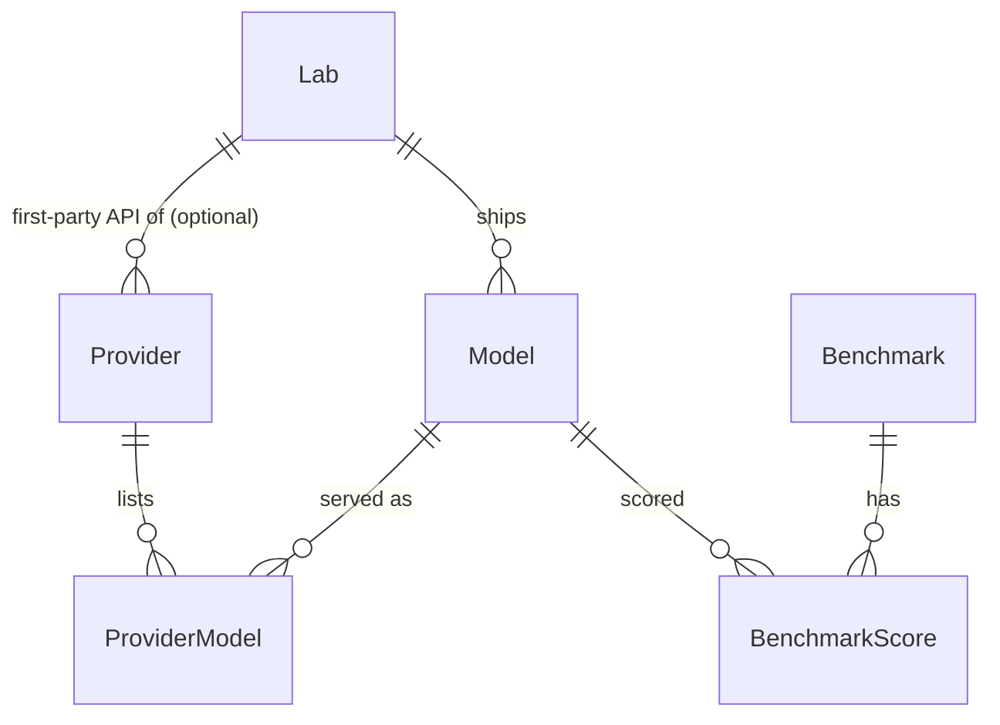

# 04 Data model and ingestion

Schema source of truth: `prisma/schema.prisma` (already validated; init migration at `prisma/migrations/20261122000000_init`, not yet applied to any database). Inputs: `data/snapshots/*.json` (see `02-research.md` section 3).

## ER diagram



## Semantics you must not get wrong

- **Prices are USD per 1M tokens.** `null` = unknown, `0` = free. `isFree = input === 0 && output === 0` only when both are known.
- `Model.inputPrice/outputPrice/...` is the **reference price**: first-party listing (provider whose slug equals the lab slug) -> else the `openrouter` listing -> else the median across listings. Per-provider prices live on `ProviderModel`. `blendedPrice = (3*input + output)/4` (`src/lib/pricing.ts`), null if either side is null.
- `Model.providerCount` = number of **distinct providers** with a listing. A provider may have several listings for one model (e.g. Bedrock regional ids), so listings >= providers.
- `intelligenceIndex` is a denormalised copy of the `intelligence` benchmark value (for sorting and the value score). Source of truth is `BenchmarkScore`.
- `BenchmarkScore.rank` is precomputed at ingest over **all** scored models for that benchmark (1 = best, ties share a rank). Filtered leaderboards compute their own display rank.
- `searchKey` = lowercase, `[a-z0-9]` only, of `lab.slug + lab.name + model.name + model.slug`. Queries are normalised the same way, then `contains` (case-insensitive), which the `pg_trgm` GIN index accelerates.
- Dates are `DATE`. Partial dates from sources ("2025-05") become the 1st of that month.
- URL identity: `/models/{lab.slug}/{model.slug}` equals models.dev's `canonical_model_id` (`lab/slug`) for canonical models.

## Ingestion pipeline (roadmap P1 builds this under `scripts/ingest/`)

`npm run ingest:fetch` downloads both sources to `data/snapshots/` and rewrites `MANIFEST.json`. `npm run db:seed` reads **only the snapshots**. Both are idempotent.

```
1. read + Zod-validate source rows (bad rows: log, skip, count; never crash the run)
2. build canonical models from models.dev: group rows by canonical_model_id
3. join OpenRouter entries to canonical models (key function below)
4. add OpenRouter-only models (no canonical twin)
5. derive per-model fields, reference price, providerCount, searchKey
6. upsert labs, providers, models; replace listings and scores
7. compute BenchmarkScore.rank and Model.intelligenceIndex
8. print a report: counts per table, matched/unmatched/ambiguous joins, skipped rows by reason
```

### Join key (unit test this first; it is the riskiest logic)

```ts
const LAB_ALIAS = { qwen: "alibaba", "z-ai": "zhipuai", "x-ai": "xai", mistralai: "mistral", "meta-llama": "meta", bytedance: "bytedance-seed" };
// skip entirely: ids starting with "~" (OpenRouter "latest" aliases) and the "openrouter/" prefix (routers, not models)
function joinKey(lab: string, slug: string) {
  const l = LAB_ALIAS[lab] ?? lab;
  const s = slug.toLowerCase()
    .replace(/:.*$/, "")                       // :free  :batch  :thinking
    .replace(/-?(20\d{2}-?\d{2}-?\d{2})$/, "") // trailing date 20250929 / 2025-09-29
    .replace(/[^a-z0-9]/g, "");                // dots, dashes, underscores
  return `${l}/${s}`;
}
```
Apply `joinKey` to both canonical ids (`lab/slug`) and OpenRouter ids. **Measured with the baseline snapshots: 283 of 357 OpenRouter keys match, 5 ambiguous, 74 unmatched.** Ambiguity rule: prefer the canonical id whose raw `lab/slug` equals the OpenRouter id (after lower-casing), else the shortest slug; if still tied, leave unjoined and log. Variants: among OpenRouter entries sharing a key, prefer the one without a `:` suffix for specs; if only variants exist use the first.

### models.dev -> our tables

| Source | Target | Rule |
|--------|--------|------|
| provider `id,name,api,doc` | `Provider.slug,name,apiUrl,docUrl` | Keep only providers with >= 1 canonical listing. `labId` = Lab with the same slug if it exists |
| canonical prefix | `Lab.slug` | `Lab.name` = first-party provider's `name` if present, else a small override map, else Title Case of the slug |
| canonical group -> **primary row** | most `Model` fields | Primary = first-party row, else the row with most non-null fields (ties: latest `last_updated`) |
| `name, description, family` | same | OpenRouter `description` only as fallback (it is truncated with "...") |
| `release_date` / `knowledge` | `releasedAt` / `knowledgeCutoff` | Parse partial dates; OpenRouter `created` (unix seconds) as `releasedAt` fallback |
| `limit.context / output` | `contextWindow / maxOutputTokens` | OpenRouter `context_length` / `top_provider.max_completion_tokens` as fallback |
| `modalities.input/output` | `inputModalities/outputModalities` | Lower-case; map OpenRouter `file` to `pdf`; `vision = input has image` |
| `reasoning, tool_call, structured_output, open_weights` | booleans | From the primary row |
| `type` | `ModelType` | `chat`/missing -> TEXT; image, video, embedding, speech, transcription, `reranking`->RERANK, realtime. OpenRouter-only: output has image -> IMAGE, video -> VIDEO, audio -> SPEECH, else TEXT |
| `status === "deprecated"` | `Model.deprecated` | true only if **every** row is deprecated; `ProviderModel.status` keeps the raw status |
| every row with a canonical id | `ProviderModel` | `providerModelId = row.id`; `contextWindow=limit.context`, `inputLimit=limit.input`, `maxOutputTokens=limit.output`, prices from `cost` (`reasoning` -> `reasoningPrice`), flags (undefined -> null), `sourceUpdatedAt = last_updated` |

Ignored in MVP (stretch): `cost.tiers`, `cost.context_over_200k`, audio prices, `reasoning_options`, `interleaved`, `experimental`, rows without `canonical_model_id`.

### OpenRouter -> our tables

| Source | Target |
|--------|--------|
| matched entry id | `Model.openrouterId` (OpenRouter-only models are created here) |
| `benchmarks.artificial_analysis.<k>_index` (non-null) | `BenchmarkScore`, see catalogue |
| `benchmarks.design_arena[]` | `BenchmarkScore` (`value = elo`, `winRate = win_rate`) |
| OpenRouter-only model | fields from OpenRouter: `pricing.prompt/completion/input_cache_read/input_cache_write` via `perTokenToPerMillion`, `context_length`, `architecture.*`, `supported_parameters` (`reasoning`, `tools`, `structured_outputs` -> flags). Lab = `LAB_ALIAS[prefix] ?? prefix`. No provider listings (so `providerCount = 0`) |

`benchmarks` may be **absent** on an entry (202 of 476 today): treat as no scores.

### Benchmark catalogue (create a `Benchmark` row only if it ends up with >= 10 scored models)

| key | name | group | category | unit |
|-----|------|-------|----------|------|
| `intelligence` | Intelligence Index | Artificial Analysis | general | index |
| `engineering`, `finance-accounting`, `healthcare-medical`, `legal`, `strategy-ops`, `economics`, `cyber`, `decision`, `multilingual` | e.g. "Legal Index" | Artificial Analysis | domain | index |
| `arena-<category>` for each Design Arena category (website, codecategories->"Code", gamedev, uicomponent, 3d, dataviz, svg, asciiart, mobileapps, pdf, webapps, fullstack, androidnative, spreadsheet, ...) | readable name | Design Arena | `design` (arena=models) or `design-agents` (arena=agents) | elo |
| `arena` (derived) | "Design Arena (average)" | Design Arena | design | elo | mean Elo over the `models`-arena categories, only when the model has >= 4 of them. Mark as derived in `sourceUrl`/name |

Skip `openness_index` (it measures licence openness, not capability). `coding` and `agentic` are **not available** from OpenRouter today: do not create empty benchmarks; stretch = Artificial Analysis API.

### Rankings (boards served by `/api/v1/rankings/{board}`)

| board | measure | order | rule |
|-------|---------|-------|------|
| `reach` | `providerCount` | desc | models with >= 1 provider |
| `intelligence` | `intelligenceIndex` | desc | scored models |
| `value` | `intelligenceIndex / blendedPrice` | desc | both known and blended > 0 |
| `cheapest` | `blendedPrice` | asc | blended known and > 0 (exclude free from "cheapest" but offer `free` filter) |
| `context` | `contextWindow` | desc | known |
| `newest` | `releasedAt` | desc | known |
| any benchmark `key` | `BenchmarkScore.value` | per `higherIsBetter` | scored |

Display rank = `RANK() OVER (ORDER BY measure)` within the **filtered** set (ties share a rank).

### Idempotency and performance

- Natural keys: `Lab.slug`, `Model(labId, slug)`, `Provider.slug`, `ProviderModel(providerId, providerModelId)`, `Benchmark.key`, `BenchmarkScore(modelId, benchmarkId)`. Running the seed twice yields identical counts.
- Labs/providers/models: upsert (keeps ids stable). Listings and scores: replace (delete-then-`createMany`, chunks of ~1000) inside a transaction.
- **Prisma interactive transactions time out at 5 s by default**: pass `{ timeout: 120_000, maxWait: 30_000 }` or split into several transactions. Target a full seed under ~2 minutes on Neon.

### Sanity bands after seeding (investigate if outside)

| Table | Expected |
|-------|----------|
| Lab | 40 to 90 |
| Model | 600 to 850 (about 658 canonical + about 74 OpenRouter-only) |
| Model with `openrouterId` | >= 300 |
| Provider | 200 to 324 |
| ProviderModel | 7,500 to 8,700 |
| Benchmark | >= 15 |
| BenchmarkScore | >= 1,500 |
| Models with `intelligenceIndex` | >= 150 |

### Stretch ingest (only after the MVP cut line)

Orphan rows (no `canonical_model_id`, 925 distinct ids): group by normalised id, attach to first-party providers' models or create models under a lab guessed from the provider. OpenRouter `/models/{id}/endpoints` for uptime/latency. Artificial Analysis API for coding/agentic indices. Price tiers (`context_over_200k`).
