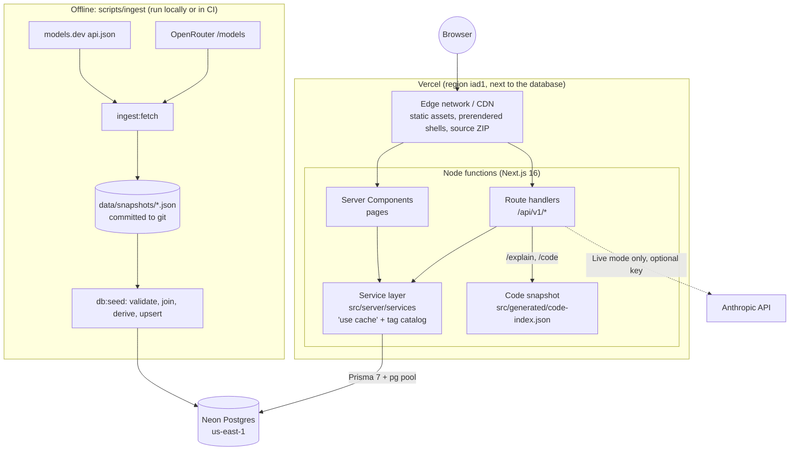
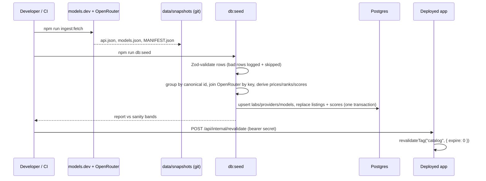
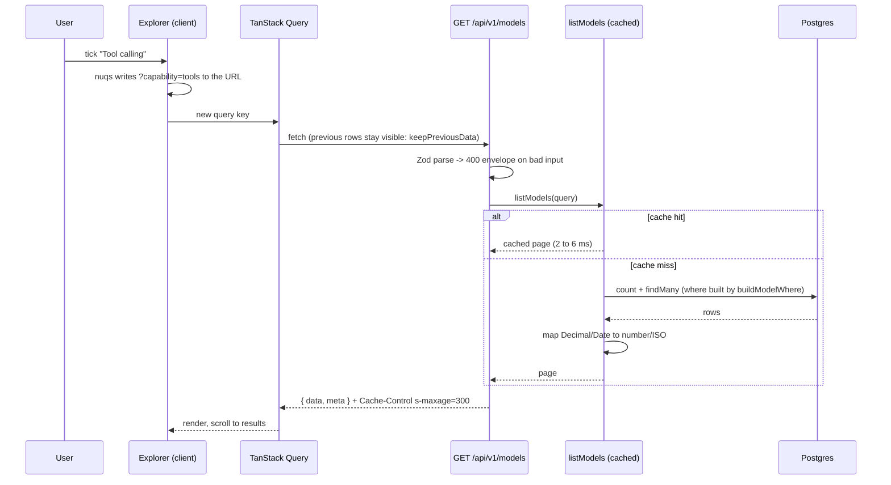

# 09 System design

How OneAtlas is put together, why, and how it behaves under load and failure. This is the reference a new engineer or a reviewer should read after the README. Decisions and their history live in [`03-architecture.md`](03-architecture.md); the schema is in [`10-database-design.md`](10-database-design.md); the API contract is in [`05-api-spec.md`](05-api-spec.md).

## 1. Problem and scope

Developers choosing an AI model need to answer "which model, from which provider, at what price, with which capabilities, and how good is it?" The data exists, but it is scattered across provider pricing pages, aggregator APIs and benchmark sites.

OneAtlas ingests two public sources, normalises and joins them, stores the result in Postgres and serves it through a typed REST API and a server-rendered web app.

| In scope | Out of scope (deliberately) |
|---|---|
| Read-only catalog: 724 models, 91 labs, 307 providers, 8,618 listings, 30 benchmarks | User accounts, writes, admin CRUD |
| Search, faceted filters, sorting, pagination, compare, leaderboards | Live provider uptime or latency |
| Public REST API (`/api/v1`) with a stable error contract | Long-context or batch price tiers |
| A browsable, downloadable copy of the source (`/code`) and an assistant that explains it | Real-time data (the catalog changes at ingest, not per request) |

**Workload shape.** Reads only; data changes when someone re-runs the seed (daily at most). The whole catalog is about 8 MB of tables and indexes in Postgres. That combination drives most decisions below: cache aggressively, precompute at ingest, keep the request path short.

## 2. Architecture overview



### Components

| Component | Responsibility | Lives in |
|---|---|---|
| Ingestion | Download sources to committed snapshots; validate, join, derive and upsert into Postgres; print a sanity report | `scripts/ingest/` |
| Database | Normalised catalog with denormalised hot columns and precomputed ranks | Neon Postgres, `prisma/` |
| Service layer | All business logic and **all** database access; every read cached with tag `catalog` | `src/server/services/` |
| Route handlers | Parse and validate input (Zod), call one service, shape the JSON envelope, set cache headers | `src/app/api/v1/**/route.ts` |
| Pages | Server Components render the first view from the same services; client islands take over for interaction | `src/app/**/page.tsx`, `src/components/` |
| Client data layer | URL state (nuqs) drives TanStack Query calls to `/api/v1/*`, hydrated from the server render | `src/components/explorer/`, `src/lib/api.ts` |
| Code snapshot | Build-time copy of the source for the `/code` viewer, the ZIP download and the assistant | `scripts/build-code-index.ts`, `src/server/code-index.ts` |
| Assistant | Prepared answers in the browser (free); optional Live mode calls Claude with read-only code tools | `src/components/ask/`, `src/server/explain/` |

### Layering rule

```
route handler / page  ->  service  ->  Prisma (src/lib/db.ts)  ->  Postgres
        (thin)          (logic + cache)       (one client per process)
```

Nothing outside `src/server/services/` imports the database client. Pages and route handlers call the same service functions, so the server-rendered page and the API can never disagree.

## 3. Key flows

### 3.1 Ingestion (offline)



Snapshots are committed, so seeding is deterministic and works offline; a broken upstream can never break a deploy. The seed is idempotent (natural keys + upsert/replace) and takes about 55 s against Neon. Details: [`04`](04-data-model-and-ingestion.md).

### 3.2 A page view (`/`)

1. The CDN serves the **prerendered static shell** (header, hero, skeletons) immediately. Partial Prerendering streams the dynamic parts into it.
2. The explorer's server part reads `searchParams`, parses them with the same nuqs parsers the browser uses, and calls `listModels(query)`.
3. `listModels` is a `'use cache'` function: a cache hit returns in a few milliseconds; a miss runs one `count` and one `findMany` (both index-backed) and caches the plain-object result for hours.
4. The client `Explorer` hydrates with that result as TanStack Query `initialData` under the **same query key**, so there is no second request after hydration.

### 3.3 An interaction (filter change)



## 4. Caching

Three layers, each with a clear owner and invalidation path:

| Layer | What | Lifetime | Invalidation |
|---|---|---|---|
| Data cache | Service results (`'use cache'`, `cacheLife('hours')`, `cacheTag('catalog')`) | Hours | `POST /api/internal/revalidate` expires the tag; a redeploy also clears it |
| HTTP / CDN | API responses: `public, s-maxage=300, stale-while-revalidate=3600`; errors `no-store` | 5 min fresh, 1 h stale | Expires on its own; short enough that a re-seed shows within minutes |
| Static | Prerendered shells, `generateStaticParams` pages (top 50 models, labs, providers), JS/CSS, `oneatlas-source.zip` | Until next deploy | Redeploy |

Rules that keep this correct (enforced by Next 16 Cache Components):
- Cached functions take and return plain serialisable values. `Decimal` and `Date` are converted inside the mapper.
- Anything reading `searchParams`, `params`, `cookies()` or `headers()` sits under `<Suspense>`, so it streams into the static shell instead of making the whole page dynamic.
- Errors thrown inside `'use cache'` lose their class, so cached loaders return `null` for "not found" and the caller maps that to a 404.

## 5. Reliability

| Failure | Behaviour |
|---|---|
| Transient DB connection error (P1001/P1002/P1017) | Retried 3 times with backoff (150, 500, 1500 ms) inside the Prisma client extension. All queries are reads, so retries are safe |
| Database down | Cached pages and API responses keep serving from the data cache and CDN; `/api/v1/health` returns 503 so monitoring sees it |
| Bad input | Zod returns `400 INVALID_QUERY` with field-level details; nothing reaches the database |
| Unknown entity | `404 NOT_FOUND` (API). Pages render the branded 404 |
| Unexpected error | `500 INTERNAL` with a generic message and a request id; the full error is logged server-side, never sent to clients |
| A page section throws | `error.tsx` renders a branded retry state instead of a blank page |
| Upstream source breaks | No effect on the running site: the app reads Postgres, and seeding reads committed snapshots |
| Assistant API unavailable or no key | Live mode is hidden; prepared answers work entirely in the browser |

Connection budget: the pg pool is capped at **5 connections per function instance**, and the runtime uses Neon's **pooled** endpoint (PgBouncer), so a burst of serverless instances cannot exhaust Postgres connections.

## 6. Security

- **Secrets** live only in Vercel environment variables and the local `.env` (gitignored, never committed). There are no `NEXT_PUBLIC_*` variables; build output and the code snapshot are checked for secret values.
- **Input** is validated with Zod at every boundary (lengths, ranges, enums, slug patterns). `ILIKE` wildcards in user text are escaped; the only raw SQL is parameterised.
- **Headers** on every response: CSP (same-origin scripts, styles, fonts, fetches; no framing, no plugins), `X-Content-Type-Options: nosniff`, `X-Frame-Options: DENY`, `Referrer-Policy`, `Permissions-Policy`, HSTS. `X-Powered-By` is off.
- **Code snapshot** is allow-listed (`src`, `scripts`, `docs`, configs) and excludes `.env*` and generated files. File requests are looked up in the snapshot, never resolved on disk, so path traversal is impossible.
- **Costly endpoint** (`POST /explain`): per-client sliding-window limit (12 per 10 min), 256 KB body cap, 2,000-character question cap, at most 6 tool rounds. Links in model output are restricted to http(s) and same-site paths.
- **Admin endpoint** (`POST /api/internal/revalidate`): bearer token compared in constant time; answers 404 when unset or wrong, so it does not advertise itself.

Known trade-off: the CSP allows inline scripts, because per-request nonces would force every page to render dynamically and give up the prerendered shells.

## 7. Performance

| Measure | Result |
|---|---|
| API, warm (data cache hit) | 2 to 6 ms per endpoint (local `next start`) |
| API, cold (cache miss) | 0.5 to 0.9 s for lists from a laptop to Neon us-east-1; in production the function runs in the same region |
| LCP, home page | 0.9 s under 4x CPU throttling + slow network (the hero text paints with the first frame) |
| Lighthouse mobile | 91 to 94 performance, 100 accessibility, 100 best practices, CLS 0 on the main pages |
| JavaScript, home page | about 262 KB transferred; the assistant panel, command palette and charts load on first use |

What makes it fast: prerendered shells, cached service reads, denormalised sort columns with matching indexes, precomputed ranks, one query key shared by server and client, and lazy client islands.

## 8. Capacity and scaling

Today the full catalog is roughly 10k rows across six tables. Every list query is an index scan plus a count; filtered rankings and search relevance are computed in memory over at most about 1k light rows.

| If this grows 100x (70k models, 860k listings) | Change |
|---|---|
| Offset pagination gets slow on deep pages | Keyset pagination on `(sortColumn, id)` |
| In-memory filtered ranks and matrix | `RANK() OVER` in SQL, or materialised views refreshed at ingest |
| Trigram search over a much larger key set | `tsvector` + GIN, or a search service (Typesense, Meilisearch) |
| Facet counts on every filter change | Precomputed facet tables per common filter, refreshed at ingest |
| Read traffic | Neon read replicas behind the service layer; the API is already CDN-cacheable |
| Abuse of the costly endpoint | Global rate limit at the edge (Vercel Firewall or a KV-backed limiter) instead of per-instance memory |
| Ingest duration | Incremental ingest (diff snapshots, touch only changed rows) and scheduled runs in CI |

Nothing in the request path holds state between requests except the per-instance rate limiter, so horizontal scaling is automatic on Vercel.

## 9. Observability

- `GET /api/v1/health`: DB ping + model count, never cached; suitable for an uptime monitor.
- Server errors log with a request id (`src/server/http.ts`); Vercel's runtime logs collect them.
- The seed prints a report (row counts, join results, skipped rows by reason) checked against sanity bands in [`04`](04-data-model-and-ingestion.md).
- Next step: error tracking (Sentry or Vercel Observability) and a `x-request-id` response header.

## 10. Deployment topology

| Piece | Where |
|---|---|
| App (static + functions) | Vercel, functions pinned to `iad1` (`vercel.json`) next to Neon `aws-us-east-1` |
| Database | Neon Postgres 17: pooled URL at runtime, direct URL for migrations |
| Source of truth for data | `data/snapshots/` in git |
| Build-time artefacts | `src/generated/` (Prisma client, code index, anchors) and `public/oneatlas-source.zip`, all rebuilt on every install/build and gitignored |

Step-by-step deployment: [`08-deploy-and-submission.md`](08-deploy-and-submission.md).
