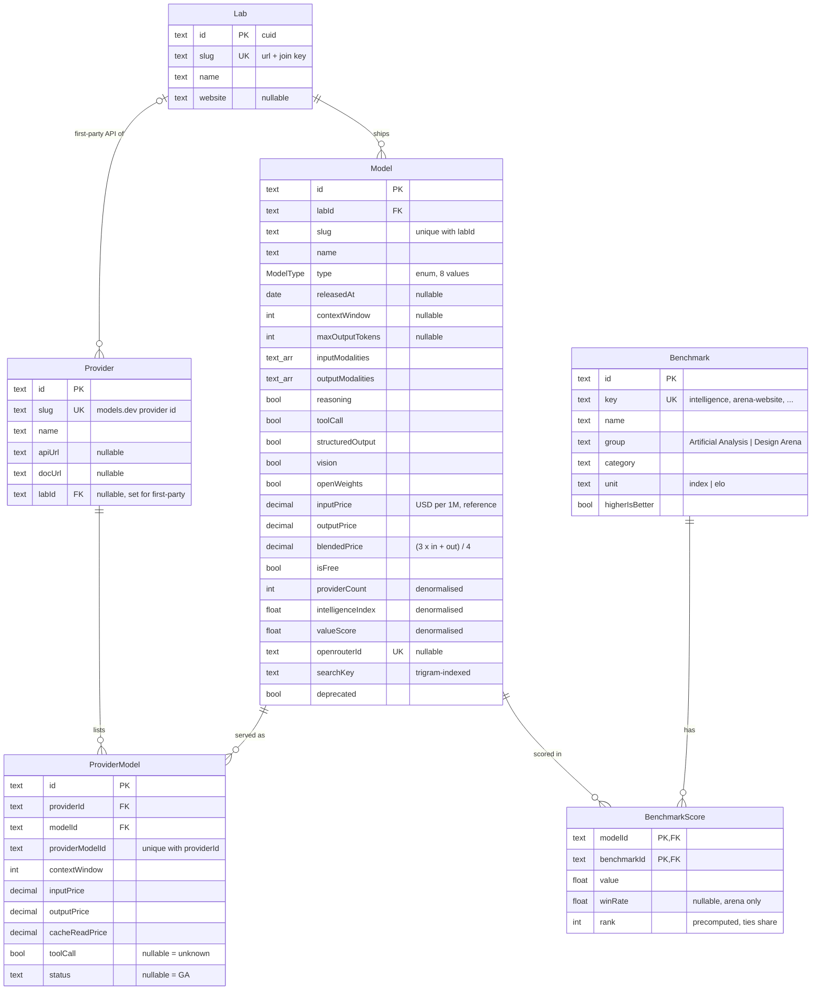

# 10 Database design

PostgreSQL 17 on Neon, accessed only through Prisma 7 from the service layer. Source of truth: [`prisma/schema.prisma`](../prisma/schema.prisma) and [`prisma/migrations/`](../prisma/migrations). How rows get there: [`04-data-model-and-ingestion.md`](04-data-model-and-ingestion.md).

## 1. Design goals

1. **Every read the UI makes is one indexed query.** Sorts and leaderboards read precomputed columns; nothing aggregates at request time.
2. **Exact money.** Prices are `Decimal(12,6)` (sub-cent values such as $0.075 stay exact) and become `number` only in the API mapper.
3. **Idempotent ingest.** Every table has a natural key, so the seed can upsert and replace without duplicating anything.
4. **Honest unknowns.** `null` means "the source did not say"; `0` means free; booleans that may be unknown are nullable.

## 2. Entity-relationship diagram

(Columns abbreviated: every table also has `createdAt`/`updatedAt` except `BenchmarkScore`; `Model` also carries `description`, `family`, `knowledgeCutoff`, `cacheReadPrice`, `cacheWritePrice`; `ProviderModel` also has `inputLimit`, `maxOutputTokens`, `reasoningPrice`, `cacheWritePrice`, `reasoning`, `structuredOutput`, `temperature`, `sourceUpdatedAt`.)

## 3. Table dictionary

| Table | Rows (seeded) | Grain | Natural key | Notes |
|---|---|---|---|---|
| `Lab` | 91 | One organisation that builds models | `slug` | 83 from models.dev canonical ids + 8 that exist only on OpenRouter |
| `Model` | 724 | One canonical model (`lab/slug`) | `(labId, slug)` | 658 canonical + 66 OpenRouter-only. Carries the **reference price** and denormalised sort columns |
| `Provider` | 307 | One API that serves models | `slug` | `labId` set when the provider is the lab's own API (first-party) |
| `ProviderModel` | 8,618 | One model offered by one provider under one id | `(providerId, providerModelId)` | A provider may list a model several times (regional ids), so listings >= providers |
| `Benchmark` | 30 | One benchmark / index | `key` | Only created when at least 10 models have a score |
| `BenchmarkScore` | 1,964 | One model's score on one benchmark | `(modelId, benchmarkId)` (composite PK) | `rank` precomputed over all scored models, 1 = best, ties share |

### Denormalised columns (and their source of truth)

| Column | Derived from | Why |
|---|---|---|
| `Model.inputPrice` / `outputPrice` / `cache*Price` | First-party listing, else OpenRouter, else median of listings | One price per model for sorting, cards and the value score |
| `Model.blendedPrice` | `(3 x input + output) / 4` (`src/lib/pricing.ts`) | "Price" sort and the cheapest board |
| `Model.providerCount` | `count(distinct providerId)` over listings | Default sort ("most available") and the reach board |
| `Model.intelligenceIndex` | `BenchmarkScore.value` for `intelligence` | Intelligence sort without a join |
| `Model.valueScore` | `intelligenceIndex / blendedPrice` | Value sort and board |
| `Model.vision` | `"image" in inputModalities` | A plain boolean filter |
| `Model.isFree` | Both prices known and `0` | Free filter |
| `Model.searchKey` | Lowercase `[a-z0-9]` of lab slug + lab name + model name + slug | "gpt4o" matches "GPT-4o" |
| `BenchmarkScore.rank` | Competition rank per benchmark | "#3 of 65" without window functions per request |

All are recomputed on every seed, inside the same run that writes their sources, so they cannot drift.

## 4. Constraints and integrity

| Constraint | Purpose |
|---|---|
| `Lab.slug`, `Provider.slug`, `Benchmark.key` unique | URL identity and idempotent upserts |
| `Model (labId, slug)` unique | `/models/{lab}/{slug}` is unambiguous |
| `Model.openrouterId` unique | One canonical model per OpenRouter entry |
| `ProviderModel (providerId, providerModelId)` unique | One row per provider listing id |
| `BenchmarkScore (modelId, benchmarkId)` primary key | One score per model per benchmark |
| FK `Model.labId -> Lab.id` | Every model belongs to a lab |
| FK `ProviderModel -> Provider, Model` with `ON DELETE CASCADE` | Replacing a model or provider removes its listings |
| FK `BenchmarkScore -> Model, Benchmark` with `ON DELETE CASCADE` | Same for scores |
| FK `Provider.labId -> Lab.id` (nullable) | Marks first-party providers |
| `ModelType` enum | Closed set of model types: TEXT, IMAGE, VIDEO, EMBEDDING, SPEECH, TRANSCRIPTION, RERANK, REALTIME |

## 5. Query patterns and the indexes that serve them

| Query (service) | Shape | Index |
|---|---|---|
| Explorer default sort (`listModels`) | `ORDER BY providerCount DESC, id` | `Model_providerCount_idx` |
| Sort by price / context / release / intelligence / value | `ORDER BY <column>` | `Model_blendedPrice_idx`, `Model_contextWindow_idx`, `Model_releasedAt_idx` (DESC), `Model_intelligenceIndex_idx` (DESC), `Model_valueScore_idx` (DESC) |
| Search (`listModels`, `search`) | `searchKey LIKE '%key%'` | `Model_searchKey_trgm_idx` (GIN, `gin_trgm_ops`) |
| Filter by type / lab | `type IN (...)`, `labId IN (...)` | `Model_type_idx`, `Model_labId_idx` |
| Filter by provider | `EXISTS (listing WHERE providerId IN (...))` | `ProviderModel_providerId_idx` |
| Model detail listings (`getModel`) | `ProviderModel WHERE modelId = ?` | `ProviderModel_modelId_idx` |
| Provider page (`getProvider`) | `ProviderModel WHERE providerId = ? ORDER BY ...` | `ProviderModel_providerId_idx` |
| Benchmark leaderboard / leader (`rankedEntries`, `listBenchmarks`) | `BenchmarkScore WHERE benchmarkId = ? ORDER BY rank` | `BenchmarkScore_benchmarkId_rank_idx` |
| URL lookups | `Lab.slug`, `Model (labId, slug)`, `Provider.slug` | The unique indexes |

The trigram index is hand-written in the init migration (Prisma cannot express `gin_trgm_ops`). **Never let a generated migration drop it**: check every new migration for `DROP INDEX "Model_searchKey_trgm_idx"` (this happened once, see the decision log in `03`).

## 6. Data types

| Choice | Why |
|---|---|
| `text` ids with `cuid()` | Stable across re-seeds (upsert by natural key keeps the id), opaque, URL-safe |
| `Decimal(12,6)` for prices | Exact; up to $999,999.999999 per 1M tokens |
| `Date` (not timestamp) for release and knowledge dates | Sources give days or months; partial dates ("2025-05") are stored as the 1st |
| `text[]` for modalities | Small closed sets, filterable with `hasSome`, no join table needed |
| `Float` for benchmark values | Scores are measurements, not money |
| `Boolean?` on listings | Distinguishes "no" from "the source did not say" |

## 7. Lifecycle and operations

- **Writes** happen only in `scripts/ingest/seed.ts`: labs, providers, models are upserted (ids stay stable); listings and scores are deleted and re-inserted with `createMany` in chunks, inside a transaction with a long timeout. Running it twice produces identical counts.
- **Reads** happen only in `src/server/services/`, all cached under the `catalog` tag. After a re-seed, `POST /api/internal/revalidate` expires them.
- **Connections:** runtime uses Neon's pooled endpoint (`DATABASE_URL`), the Prisma CLI uses the direct endpoint (`DIRECT_URL`, see `prisma7.config.ts`). The app pool is capped at 5 per instance.
- **Backups:** Neon point-in-time restore covers the database; the data itself is reproducible from `data/snapshots/` in git at any commit.

## 8. Migrations

| Migration | What |
|---|---|
| `20261122000000_init` | All tables, enums, indexes and FKs; `CREATE EXTENSION pg_trgm`; the GIN trigram index on `Model.searchKey` (hand-written) |
| `20261122120000_value_score` | `Model.valueScore` column and its descending index (the generated `DROP INDEX` of the trigram index was removed by hand) |

Workflow: edit `schema.prisma` -> `npm run db:migrate` (creates and applies a migration locally) -> review the SQL (especially for the trigram index) -> commit -> `npm run db:deploy` against production before deploying code that needs it.

## 9. Size

About 8 MB of tables and indexes (16 MB for the whole database, measured). Every table fits in memory many times over on the smallest Neon compute. The scaling path for 100x data is in [`09-system-design.md`](09-system-design.md#8-capacity-and-scaling).
